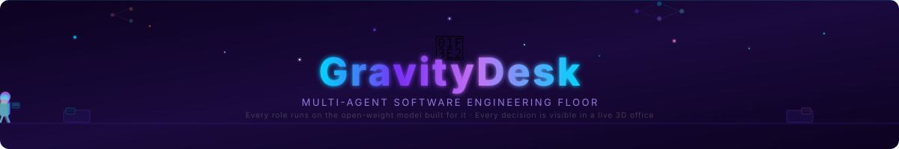
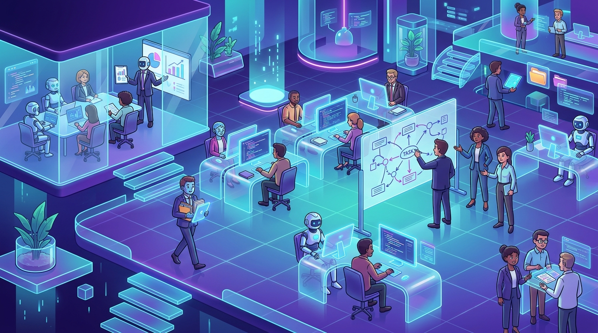
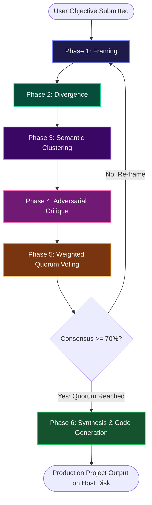
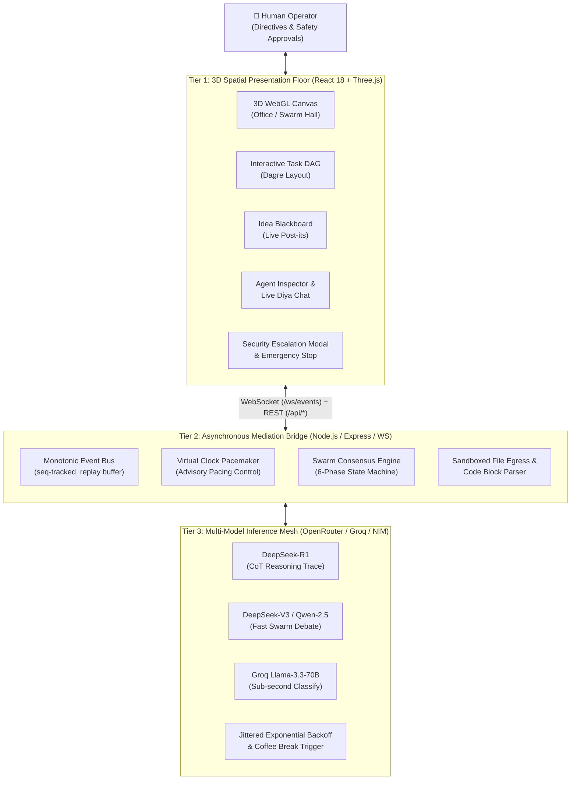
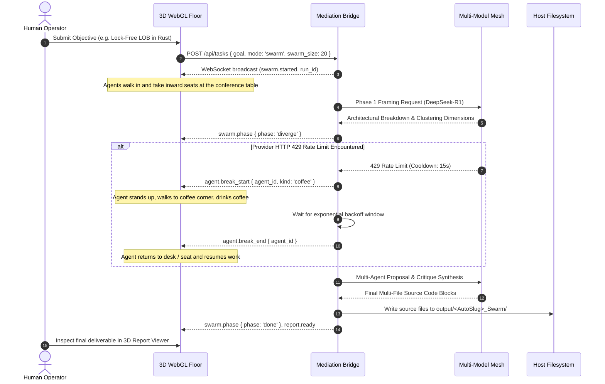

<!-- Animated Header with Walking AI Agents -->
<p align="center">
  
</p>

<!-- Hero Banner -->
<p align="center">
  
</p>

<!-- Badges -->
<p align="center">
  <a href="#"></a>
  <a href="#"></a>
  <a href="#"></a>
  <a href="#"></a>
  <a href="#"></a>
</p>

<p align="center">
  <a href="#"></a>
  <a href="#"></a>
  <a href="#"></a>
  <a href="#"></a>
  <a href="#"></a>
</p>

---

### The world's first spatially-grounded, multi-agent autonomous engineering simulation where specialized AI agents plan, debate in swarms, cross-examine architectures, and deliver production-ready code inside an observable real-time 3D workspace.

---

## 📑 Table of Contents
- [1. Executive Overview](#1-executive-overview)
- [2. The Three Failures of Current AI Coding](#2-the-three-failures-of-current-ai-coding)
- [3. Dual Working Modalities](#3-dual-working-modalities)
  - [Mode A: Deskmates Collaborative Office](#mode-a-deskmates-collaborative-office-core-team)
  - [Mode B: Swarm Hall Consensus Council](#mode-b-swarm-hall-consensus-council-10--50-agents)
- [4. The 6-Phase Swarm Consensus Protocol](#4-the-6-phase-swarm-consensus-protocol)
- [5. System Architecture & Information Flow](#5-system-architecture--information-flow)
- [6. Competitive Teardown & USPs](#6-competitive-teardown--usps)
- [7. Heterogeneous Model Inference Mesh](#7-heterogeneous-model-inference-mesh)
- [8. Security, Sandboxing & Egress Privacy](#8-security-sandboxing--egress-privacy)
- [9. Quick Start Guide](#9-quick-start-guide)
- [10. Verification & Test Suite](#10-verification--test-suite)

---

## 1. Executive Overview

Current generative AI coding tools predominantly function as isolated, single-turn text interfaces or linear pair-programming chat widgets. While suitable for single-file scripts or localized completions, this paradigm collapses on complex software engineering objectives.

**GravityDesk** fundamentally reimagines software development as a collaborative, physical engineering floor rendered in an interactive **3D isometric WebGL workspace (Three.js / React Three Fiber / WebGL)**, coordinated by an **Asynchronous Mediation Bridge**, and driven by an event-sourced monotonic execution tape.

Every agent action—architectural decomposition, peer code review, inter-agent debates, tool executions, file writing, and even **coffee breaks during API rate-limit backoffs**—is spatially visible and steerable in real time.

---

## 2. The Three Failures of Current AI Coding

```
┌────────────────────────────────────────────────────────────────────────┐
│                        WHY CONVENTIONAL AGENTS FAIL                    │
├────────────────────────────────────────────────────────────────────────┤
│ 1. CONTEXT DILUTION: One generalist prompt attempting to architect,    │
│    write backend APIs, craft CSS, and write unit tests suffers from   │
│    instruction drift, imports hallucination, and superficial logic.    │
│                                                                        │
│ 2. RATE-LIMIT FRAGILITY: High-frequency agent tool loops trigger       │
│    HTTP 429 errors on API providers, causing silent drops or crashes.  │
│                                                                        │
│ 3. COGNITIVE OPACITY: Text-only terminal harnesses dump 100,000 log    │
│    lines. A human cannot tell who is stuck, what is blocked, or why    │
│    a decision was made until token budgets are completely burned.      │
└────────────────────────────────────────────────────────────────────────┘
```

---

## 3. Dual Working Modalities

GravityDesk provides two purpose-built modes tailored to different phases of the software engineering lifecycle:

### Mode A: Deskmates Collaborative Office (Core Team)
Built for **iterative sprint execution, full-stack development, and test-driven refactoring**:
- **Core Engineering Hierarchy:**
  - 👩‍💼 **Diya (Lead Manager):** Goal formulation, DAG triage, cross-department coordination, and operator chat.
  - 👨‍💻 **Rohan (Backend Engineer):** High-throughput REST/WebSocket services, data schemas, and concurrency logic.
  - 🎨 **Kabir (Frontend Engineer):** Component trees, responsive design, UI interaction, and CSS architecture.
  - 🧪 **Nisha (QA & Test Architect):** Acceptance testing, edge-case analysis, and CI/CD validation.
- **Physical Zone Dynamics:** Agents physically walk via **A\* NavMesh pathfinding** between workstations, meeting rooms, whiteboard standups, and the coffee pantry during token compaction.

---

### Mode B: Swarm Hall Consensus Council (10 – 50 Agents)
Built for **high-stakes architectural design, systems synthesis, and zero-compromise engineering**:
- **The Grand Deliberation Hall:** An oval conference amphitheater where 10, 20, or 50 specialized agents sit in **inward-facing executive chairs** around a centralized conference table with Moderator Diya at the podium.
- **Specialized Roles:** Security Auditors, Distributed Systems Architects, Real-Time Latency Engineers, Memory Safety Specialists, Formal Verifiers, Performance Profilers, and Protocol Engineers.
- **Dynamic Deliverables:** Synthesizes complete, production-ready multi-file implementations written directly to the host filesystem under `output/<ProjectSlug>_Swarm/`.

---

## 4. The 6-Phase Swarm Consensus Protocol

To eliminate echo-chambers and guarantee rigorous architectural evaluation, the Swarm operates under a mathematical 6-phase consensus protocol:



1. **Phase 1: Framing** — Lead Manager Diya deconstructs the prompt into orthogonal architectural vectors (e.g., Memory Layout, Concurrency, Zero-Copy IPC, Audit Logging).
2. **Phase 2: Divergence (Proposals)** — All 20/50 specialized agents independently formulate technical proposals in isolation, preventing groupthink and early bias.
3. **Phase 3: Semantic Clustering** — Proposals are dynamically categorized into orthogonal architectural archetypes on the 3D Idea Board, reducing communication complexity from quadratic $O(N^2)$ to $O(N \cdot K)$.
4. **Phase 4: Adversarial Peer Critique** — Agents are programmatically assigned opposing stances (`SUPPORT` vs. `CHALLENGE`) to probe race conditions, memory bottlenecks, and failure modes.
5. **Phase 5: Weighted Quorum Voting** — Borda / Quadratic voting tallies agreement scores across all clusters.
6. **Phase 6: Synthesis & Code Generation** — Synthesizes the winning architectural consensus into complete, runnable multi-file source trees written directly to host storage.

---

## 5. System Architecture & Information Flow

### Component-Level Architecture


### Event Sequence & Coffee Break Flow


---

## 6. Competitive Teardown & USPs

| Capability | **GravityDesk** | **Devin / Cursor** | **AutoGPT / CrewAI** | **MetaGPT / ChatDev** |
| :--- | :---: | :---: | :---: | :---: |
| **Observability Interface** | **Interactive 3D WebGL (Three.js)** | 2D Text / Webview | Plain Terminal Logs | 2D Pixel Sprites |
| **Deliberation Architecture** | **Dual-Engine (Office + 50-Agent Swarm)** | Single-Agent Linear | Scripted DAG Graph | Fixed Waterfall Chat |
| **API Rate-Limit Handling** | **Visual 3D Coffee Break Backoff** | Fatal Error / Spinner | Crash / Silent Drop | Re-prompt Loop |
| **Deliberation Token Complexity** | **$O(N \cdot K)$ via Semantic Clustering** | N/A ($N=1$) | $O(N^2)$ Quadratic Explosion | $O(N^2)$ Linear Chat |
| **Model Heterogeneity** | **Live Failover across 4+ Open Providers** | Proprietary Closed | Single-API Provider | Single-API Provider |
| **Deep Reasoning Preservation** | **65s CoT Window for DeepSeek-R1** | Truncated Tokens | Standard 30s Timeout | Standard 30s Timeout |
| **Human-in-the-Loop Safety** | **Granular Gating + Emergency Stop** | Binary Auto-Run | Unsafe Local Execution | Mock Sandboxing |
| **Prompt Synthesis Fidelity** | **100% Dynamic / Zero Hardcoding** | Dynamic Single-File | Fragmented Output | Pre-baked Templates |

---

## 7. Heterogeneous Model Inference Mesh

GravityDesk eliminates single-provider downtime and token quota exhaustion through an adaptive routing matrix:

| Role / Function | Primary Engine | Fallback Engine | Rationale |
| :--- | :--- | :--- | :--- |
| **Lead Manager & Synthesis** | `deepseek/deepseek-r1` | `deepseek/deepseek-chat` | Full chain-of-thought (CoT) analytical depth for architectural trade-offs. |
| **Swarm Proposals & Critiques** | `deepseek/deepseek-chat` | `qwen/qwen-2.5-coder-32b` | High token velocity and instruction adherence for structured JSON/markdown. |
| **Real-Time Classification** | `groq/llama-3.3-70b-versatile` | `meta-llama/llama-3.3-70b` | Sub-300ms LPU execution for instant triage and clustering. |
| **Local Privacy Mode** | Local Ollama / vLLM (`llama3.2`) | Local Qwen-2.5 | 100% air-gapped, zero external egress execution. |

---

## 8. Security, Sandboxing & Egress Privacy

1. **Permission Escalation Gates:** No autonomous action modifying files (`file.write`), running shell commands (`bash.exec`), or pushing git refs (`git.push`) can execute without clearing the human safety gate. The calling agent pauses its Promise while a UI modal displays diffs and rationale.
2. **Emergency Stop (Kill Switch):** Hitting the red **Emergency Stop** button halts all active child processes, issues `/api/tasks/cancel_all`, terminates bridge timers, and forces all 3D agents into `IDLE`.
3. **Strict Secret Isolation:** Real `.env` files are strictly excluded via `.gitignore`. All `.env.example` templates contain zero hardcoded credentials, and git history is pre-sanitized against GitHub Push Protection triggers.

---

## 9. Quick Start Guide

### Prerequisites
- **Node.js** 20.x or higher
- **npm** 10.x or higher
- At least one active API key (OpenRouter, Groq, NVIDIA NIM, or local Ollama)

### 1. Clone & Configure
```bash
git clone https://github.com/bhalerao-aditya007/RealGravity_slayers.git
cd RealGravity_slayers

# Configure environment variables
cp .env.example .env
# Edit .env and insert your API key:
# OPENROUTER_API_KEY=sk-or-v1-...
```

### 2. Install Dependencies
```bash
# Install frontend & bridge dependencies
cd frontend
npm install
cd ..
```

### 3. Launch GravityDesk
In your first terminal, start the **Mediation Bridge Server**:
```bash
cd frontend
npm run bridge:mock
# Server starts on http://localhost:8000 (ws://localhost:8000/ws/events)
```

In your second terminal, launch the **3D Virtual Floor UI**:
```bash
cd frontend
npm run dev
# Vite dev server opens at http://localhost:5173
```

Open `http://localhost:5173` in your browser. Choose **Swarm Mode (20 or 50 Agents)**, enter your engineering prompt, and watch the autonomous simulation unfold!

---

## 10. Verification & Test Suite

The entire GravityDesk codebase is validated with an automated test suite covering kinematics, A* navmesh collisions, event reducers, and WebSocket contract protocols:

```bash
cd frontend
npm test
```

```
 ✓ src/tests/swarmLayout.test.ts (10 tests) - Ellipse seating, camera angles & bounds
 ✓ src/tests/nav.test.ts (3 tests) - A* pathfinding & collision avoidance
 ✓ src/tests/triage.test.ts (10 tests) - Department assignment & complexity rating
 ✓ src/tests/swarmTape.test.ts (3 tests) - Monotonic sequence reducer & event hydration
 ✓ src/tests/layout.test.ts (3 tests) - Furniture definitions & chair alignments
 ✓ src/tests/integration.test.ts (4 tests) - End-to-end multi-agent execution pipeline
 ✓ src/tests/stress.test.ts (1 test) - Heavy agent movement stress test
 ✓ src/tests/swarmEntrance.test.ts (2 tests) - 50-agent collision-free entrance & seating

 Test Files  8 passed (8)
      Tests  36 passed (36)
```

---

<p align="center">
  <b>GravityDesk (BenchMates / RealGravity)</b> · Built with 💜 for the next generation of autonomous engineering.
</p>
